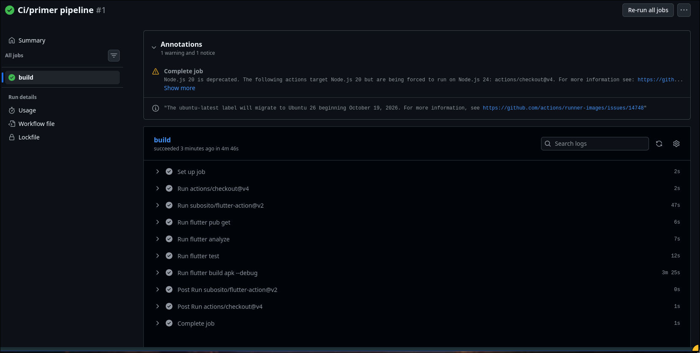
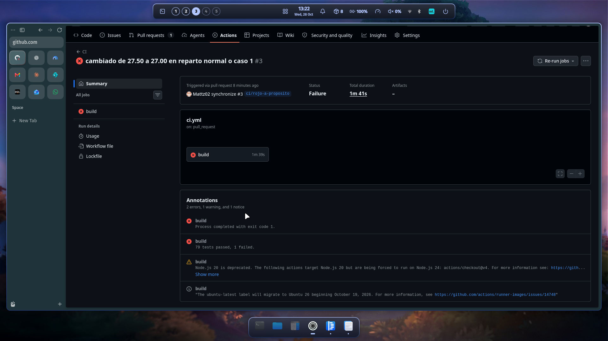
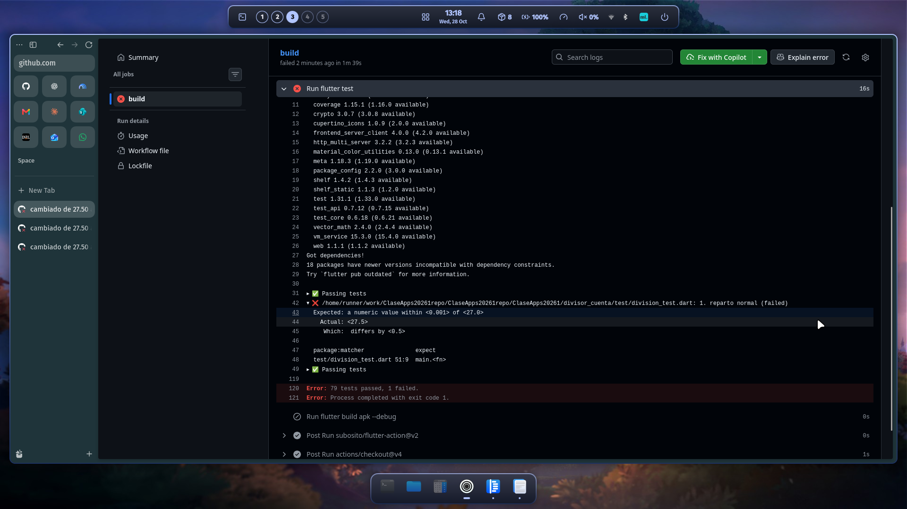
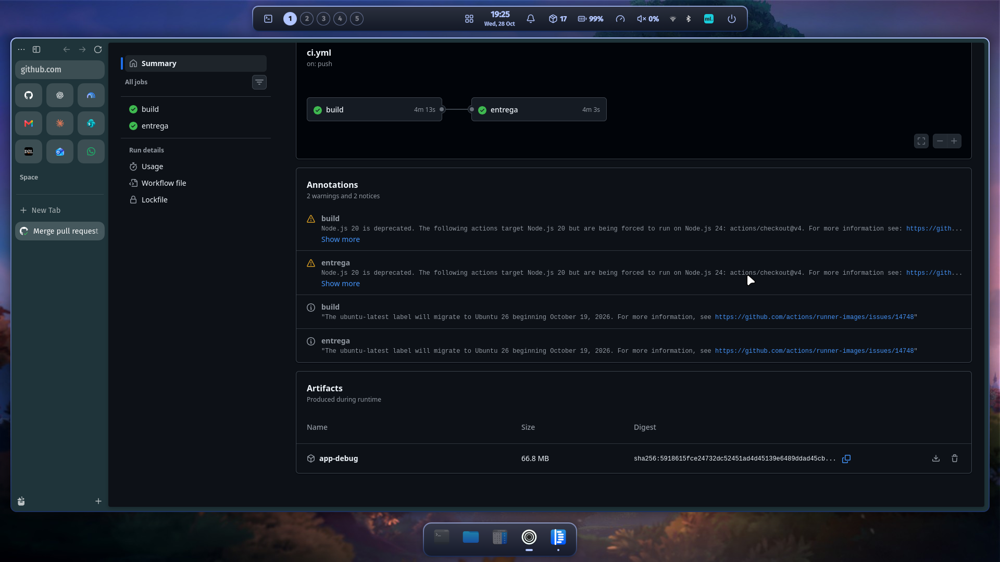
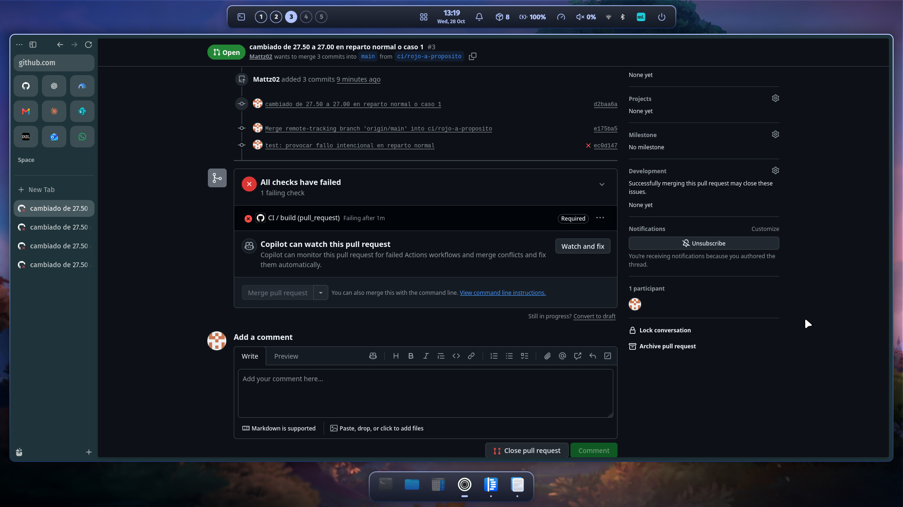
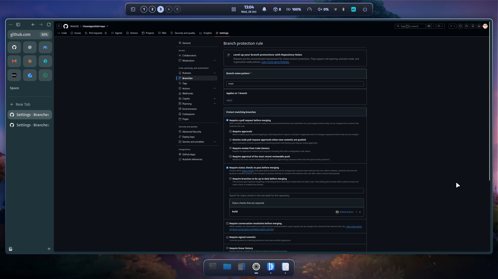
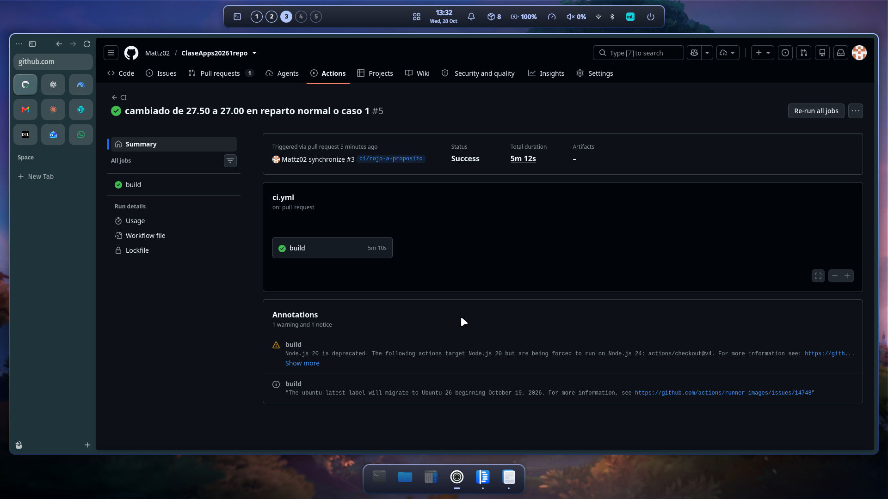

# Deber 4 — De TDD a CI/CD

## 1. Workflow y pasos

El workflow está en `.github/workflows/ci.yml`, en la raíz del repositorio. La app está en `ClaseApps20261/divisor_cuenta`.

```yaml
name: CI

on:
  push:
    branches: [main]
  pull_request:

jobs:
  build:
    runs-on: ubuntu-latest
    defaults:
      run:
        working-directory: ClaseApps20261/divisor_cuenta
    steps:
      - uses: actions/checkout@v4
      - uses: subosito/flutter-action@v2
        with:
          channel: stable
      - run: flutter pub get
      - run: flutter analyze
      - run: flutter test
      - run: flutter build apk --debug

  entrega:
    needs: build
    if: github.event_name == 'push' && github.ref == 'refs/heads/main'
    runs-on: ubuntu-latest
    defaults:
      run:
        working-directory: ClaseApps20261/divisor_cuenta
    steps:
      - uses: actions/checkout@v4
      - uses: subosito/flutter-action@v2
        with:
          channel: stable
      - run: flutter pub get
      - run: flutter build apk --debug
      - uses: actions/upload-artifact@v7
        with:
          name: app-debug
          path: ClaseApps20261/divisor_cuenta/build/app/outputs/flutter-apk/app-debug.apk
          if-no-files-found: error
```

- `flutter analyze`: revisa errores y advertencias del código sin ejecutar la app.
- `flutter test`: ejecuta las pruebas y compara lo obtenido con lo esperado.
- `flutter build apk --debug`: comprueba que Android compile y genera el APK de depuración.



## 2. Fallo intencional

Cambié el resultado esperado de `27.50` a `27.00` en el caso «1. reparto normal». El log mostró `Expected: ... <27.0>` y `Actual: <27.5>`. La línea `test/division_test.dart 51:9` señaló la comparación que falló. Pasaron 79 pruebas y falló una.





[Fragmento del log real](evidencias/parte3_log_fallo.txt).

## 3. Integración, entrega y despliegue continuos

CI verifica automáticamente los cambios con análisis, pruebas y compilación. Continuous delivery deja un artefacto disponible para una entrega posterior. Continuous deployment lo despliega automáticamente a producción sin una aprobación manual por cambio.

Implementé CI y una introducción a continuous delivery: después de pasar CI en `main`, se publica un APK como artifact de Actions. No hay despliegue a producción y el APK debug no está listo para usuarios finales.



## 4. Merge bloqueado

Exigir PR y el check `build` evita integrar cambios que incumplen las comprobaciones del pipeline. No garantiza que todo error posible quede detectado. El PR #3 estuvo bloqueado cuando falló la prueba; después de corregirla pasó CI y se fusionó.







[PR #3: fallo y corrección](https://github.com/Mattz02/ClaseApps20261repo/pull/3).

## 5. Revisión de seguridad con el agente

El agente sugirió limitar el token a `contents: read`, fijar las actions por SHA y las herramientas por versión, reutilizar el mismo APK entre jobs y definir tiempos máximos y retención del artifact. Revisé las sugerencias, pero no apliqué ninguna. Dejé esas mejoras pendientes para conservar el workflow probado del ejercicio; no las rechacé por considerarlas incorrectas.

## 6. ¿Qué garantiza realmente un CI verde?

Garantiza que las comprobaciones configuradas pasaron para ese commit en el entorno de CI. No demuestra que la app esté libre de errores, sea segura o funcione bien en todos los dispositivos. Por ejemplo, un botón podría quedar fuera de la pantalla en un teléfono pequeño y pasar en verde si ninguna prueba cubre ese tamaño.

## 7. ¿Qué detectó el pipeline que no había visto?

El fallo de `27.00` frente a `27.50` era intencional; no fue un error descubierto por sorpresa. Lo que no había advertido fueron los avisos de Actions sobre Node.js 20 en `checkout@v4` y el cambio previsto de la imagen `ubuntu-latest`. Me mostraron que el entorno puede cambiar aunque no toque el código.

## Revisión antes de entregar

- [x] Workflow en `main`, fusionado mediante los PR #2 y #4.
- [x] Cada PR ejecuta análisis, pruebas y compilación; si un paso falla, los siguientes se omiten.
- [x] El PR #3 tiene una ejecución roja y otra verde.
- [x] Captura histórica del merge bloqueado de la Parte 3 adjunta.
- [x] Repositorio público.
- [x] `main` exige PR y el check `build`, incluso para administradores; captura de protección adjunta.
- [x] `entrega` generó y subió el APK; captura del artifact adjunta.
- [x] Revisión de secretos: no se encontraron patrones comunes de claves o tokens ni archivos típicos de credenciales en los archivos versionados e historial local revisado. Esta búsqueda no garantiza ausencia absoluta de secretos.
- [x] Respuestas y evidencias incluidas en la rama `deber4`; las imágenes disponibles están enlazadas arriba.

[Run de entrega con ambos jobs verdes](https://github.com/Mattz02/ClaseApps20261repo/actions/runs/40748170448).
